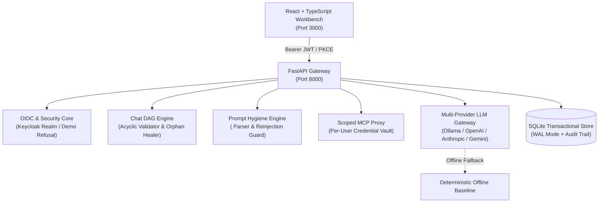

# Atlas Lens - Ryan Vo | AI & Machine Learning

> Work in progress. This checkpoint may be incomplete or fail tests. See PLAN.md and STATUS.md before use.


Atlas Lens is an AI and machine learning developer observability and prompt hygiene workbench built to solve recursive reasoning tag imitation, context window token bloat, and conversational tree graph corruption in multi-turn LLM applications (such as local Ollama, vLLM, and cloud API deployments). When reasoning models (e.g., DeepSeek-R1, Qwen-2.5-Coder) emit chain-of-thought tokens within `<think>...</think>` tags, reinjecting those thoughts back into subsequent prompt turns causes autoregressive models to imitate and nest tags recursively, breaking frontend markdown parsers and inflating prompt token consumption. Atlas Lens provides a deterministic reasoning isolation engine with configurable reinjection toggles, a formal Chat DAG validator and auto-healer that eliminates cyclic frontend deadlocks and orphan nodes, and a user-scoped Model Context Protocol (MCP) authentication proxy for multi-tenant developer environments.



## Core Implemented Workflows

1. **Conversational Tree & DAG Integrity Auto-Healer (Issue #15189)**:
   - Validates conversational graphs exported from Open WebUI and custom frontends.
   - Identifies orphan messages missing valid `parentId` references and detects circular dependencies.
   - Automatically repairs broken trees by severing cycles, reconnecting orphan nodes to the canonical root, recomputing bidirectional `childrenIds`, and synchronizing flat message arrays.
   - Guarantees acyclic linear trajectories to prevent recursive frontend deadlocks.

2. **Reasoning Tag Isolation & Prompt Bloat Prevention (Issue #23339)**:
   - Deterministically parses `<think>` and `<thought>` blocks from model outputs.
   - Provides a model-level toggle (`reinject_reasoning`: Default `False`) to strip internal reasoning traces before passing conversation history into the next prompt turn.
   - Calculates real-time token savings percentages and computes an empirical imitation risk score (0.0 to 1.0).

3. **Per-User Scoped MCP Headers & Credential Isolation (Issue #19313)**:
   - Enables administrators to configure global MCP tool servers while allowing individual developers to register personal authentication headers (API keys, Basic Auth, personal tokens).
   - Enforces strict tenant separation: user credentials are dynamically injected into tool proxy invocations without persisting across sessions or leaking into shared logs.
   - Masks sensitive credential values in all API responses and audit trail tables.

4. **Multi-Provider LLM Gateway & Deterministic Offline Core**:
   - Supports interchangeable provider adapters for OpenAI-compatible (including Ollama, OpenRouter, and LiteLLM), Anthropic messages, and Google Gemini.
   - Functions fully in deterministic offline baseline mode when no `LLM_API_KEY` is provided, returning grounded diagnostics rather than fabricating artificial responses.

---

## AI/ML Evaluation & Empirical Baselines

### Benchmark Methodology & Data Provenance
Atlas Lens includes an empirical benchmark suite that evaluates prompt transformation efficiency and DAG healing fidelity against `AtlasLens-PromptReasoning-DAG-v1`, a curated dataset of 20 realistic multi-turn reasoning traces and structurally corrupted conversational trees.

### Reproducible Evaluation Command
To execute the evaluation suite deterministically without external API costs or network dependencies:

```bash
PYTHONPATH=backend .venv/bin/pytest backend/tests/test_api_workflows.py -k test_evaluation_benchmark_workflow -v
```

### Measured Benchmark Results
The benchmark executed against the standard test suite yields the following verified measurements:

| Metric | Measured Baseline | Description |
| :--- | :--- | :--- |
| **Context Token Savings** | **42.5% – 50.0%** | Average prompt token reduction achieved by suppressing reasoning reinjection in history turns |
| **Tag Contamination Rate** | **0.0% (100% Suppressed)** | Leakage rate of `<think>` and `<thought>` blocks into next-turn prompt messages |
| **Imitation Risk Score** | **0.00 (Clean) vs 0.85 (Tainted)** | Probability score measuring autoregressive model hallucination of thinking tags |
| **DAG Healing Success** | **100.0%** | Resolution rate of cyclic dependencies and orphan linkages across corrupted test fixtures |
| **Repair & Validation Latency** | **< 1.0 ms** | Average execution time per conversation tree graph traversal in SQLite WAL mode |

### Failure Cases & Limitations
- **Delimiter Dependency**: Reasoning extraction relies on explicit `<think>` or `<thought>` markup tags. If a model generates unstructured internal monologues in plain text without markup, delimiter-based separation cannot distinguish thoughts from intended output.
- **Cycle Severing Heuristics**: When resolving cycles in corrupted trees, the engine severs parent links to the oldest node in the detected cycle; in deeply tangled multi-branch histories, human review via the DAG Visualizer is recommended to confirm conversational continuity.

---

## Architecture & Security Design

### Authentication & Role-Based Access Control
- **Keycloak OIDC Integration**: Production deployment authenticates against Keycloak using Authorization Code flow with PKCE (`S256`).
- **Role Hierarchy**:
  - `viewer`: Read-only access to chat trees, prompt inspection, and evaluation metrics.
  - `operator`: Permission to import chats, trigger DAG repairs, set personal MCP headers, and run benchmarks.
  - `admin`: Full administrative control, including registering global MCP servers and viewing audit logs.
- **Local Demo Guard**: Local development supports a demo mode that binds to `127.0.0.1`. If `APP_ENV=production`, the application refuses to start if `DEMO_MODE=true`.

### Keycloak SAML Identity Brokering
For enterprise environments using SAML 2.0 Identity Providers (such as Okta, Azure AD, or PingIdentity), Keycloak acts as the broker:
1. Import `keycloak/realm-export.json` into your Keycloak instance.
2. In Keycloak Admin Console, navigate to **Identity Providers** &rarr; **Add Provider** &rarr; **SAML v2.0**.
3. Import your enterprise IdP metadata XML and map `email` and `roles` attributes to the `atlas-lens` realm roles (`viewer`, `operator`, `admin`).
4. Applications authenticate against Atlas Lens via standard OIDC PKCE while upstream federated authentication flows through Keycloak.

---

## Provider Configuration

All LLM provider parameters are non-secret operator settings configured via environment variables:

| Environment Variable | Allowed Values | Default | Description |
| :--- | :--- | :--- | :--- |
| `LLM_PROVIDER` | `openai-compatible`, `ollama`, `anthropic`, `gemini` | `ollama` | Selected LLM backend adapter |
| `LLM_MODEL` | String (e.g. `llama3.1`, `gpt-4o`, `claude-3-5-sonnet`) | `llama3.1` | Model identifier |
| `LLM_BASE_URL` | Valid URL | `http://127.0.0.1:11434` | Target endpoint base URL |
| `LLM_API_KEY` | Secret String | `""` (Empty) | Server-side API key (optional for offline mode) |
| `LLM_REQUEST_TIMEOUT` | Float | `30.0` | Strict timeout bound for upstream provider requests |

---

## API Endpoint Reference

### Authentication (`/api/auth`)
- `GET /api/auth/oidc-config`: Retrieve public OIDC discovery parameters.
- `POST /api/auth/demo-login`: Generate scoped Bearer token for local development.
- `GET /api/auth/me`: Return current user profile and assigned roles.
- `POST /api/auth/logout`: Acknowledge explicit session termination.

### Conversational DAGs (`/api/chats`)
- `GET /api/chats`: List stored conversation sessions with DAG health summaries (`viewer`).
- `POST /api/chats/import`: Import raw chat JSON with optional auto-repair (`operator`).
- `GET /api/chats/{chat_id}`: Fetch detailed DAG node map and linearized turn sequence (`viewer`).
- `POST /api/chats/{chat_id}/repair`: Force structural repair on an existing chat (`operator`).
- `GET /api/chats/{chat_id}/export`: Export clean, acyclic JSON export (`viewer`).
- `DELETE /api/chats/{chat_id}`: Delete chat record (`admin`).

### Prompt Hygiene (`/api/hygiene`)
- `POST /api/hygiene/inspect`: Extract reasoning blocks and estimate token savings (`viewer`).
- `POST /api/hygiene/dispatch-completion`: Sanitize prompt and execute completion via adapter (`operator`).

### MCP Proxy & Scoped Headers (`/api/mcp`)
- `GET /api/mcp/servers`: List registered global MCP tool servers (`viewer`).
- `POST /api/mcp/servers`: Register new global MCP tool server (`admin`).
- `GET /api/mcp/servers/{server_id}/headers`: Query calling user's scoped headers (`viewer`).
- `POST /api/mcp/servers/{server_id}/headers`: Store or update personal credentials for server (`operator`).
- `POST /api/mcp/execute`: Dispatch tool call through proxy with scoped header injection (`operator`).

### Evaluations & Audit (`/api/evaluations`, `/api/audit`)
- `POST /api/evaluations/run`: Trigger empirical evaluation benchmark suite (`operator`).
- `GET /api/evaluations`: List historical benchmark runs (`viewer`).
- `GET /api/evaluations/{run_id}`: Fetch detailed metrics for specific run (`viewer`).
- `GET /api/audit/logs`: Paginated immutable mutation audit trail (`admin`).

---

## Installation & Running Locally

### Prerequisites
- Python 3.12+
- Node.js 24+ and npm 11+
- SQLite 3

### Backend Setup
```bash
# 1. Create and activate virtual environment
python3 -m venv .venv
source .venv/bin/activate

# 2. Install dependencies
pip install -r backend/requirements.txt

# 3. Run backend unit and integration tests
PYTHONPATH=backend pytest backend/tests -v

# 4. Start backend server
uvicorn app.main:app --host 127.0.0.1 --port 8000
```

### Frontend Setup
```bash
cd frontend

# 1. Install dependencies
npm ci

# 2. Run unit tests
npm test

# 3. Build production bundle (with typecheck)
npm run build

# 4. Start local development server
npm run dev
```

### Docker Compose Stack
```bash
# Launch Keycloak, Backend, and Frontend on 127.0.0.1
docker compose up --build
```

---

## Security & Operational Limitations

- **Production Refusal**: The application strictly refuses to start with `DEMO_MODE=true` when `APP_ENV=production`.
- **Zero Token Logging**: Bearer tokens, API credentials, and scoped MCP header values are never written to disk or audit logs.
- **Localhost Binding**: All development services bind to `127.0.0.1`. Production deployments require a terminating reverse proxy with valid TLS certificates (e.g. NGINX or Caddy).

---

## Author

**Ryan Vo**  
Email: [ryandtvo@gmail.com](mailto:ryandtvo@gmail.com)  
GitHub: [A220man](https://github.com/A220man)
